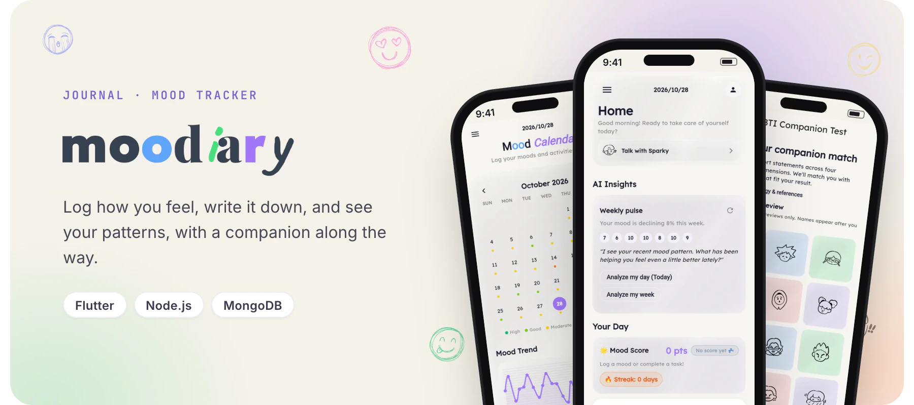
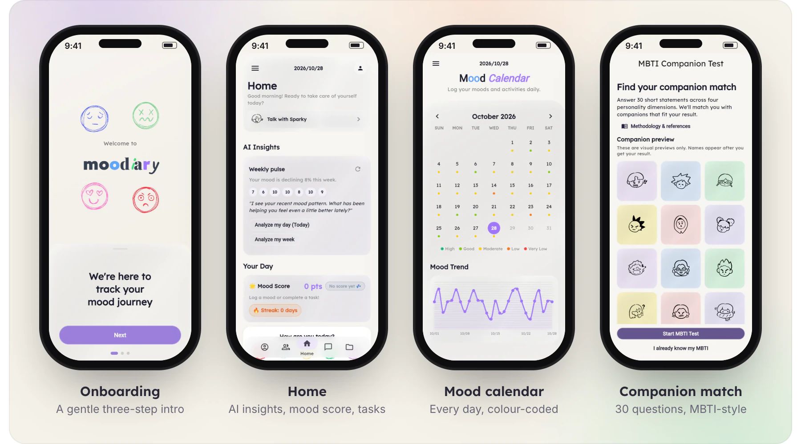

<div align="center">



<br />


</div>

<br />

**Moodiary** is a journaling and mood-tracking app. Log a mood in one tap, write about your day,
and watch the patterns build up on a calendar and trend chart. An AI companion reads your recent
moods and offers short, gentle insights, and friends and forums are there when you want company.

It is a full-stack project: a **Flutter** client for mobile, web and desktop, and a
**Node.js / Express** API with MongoDB and Socket.io.

> [!IMPORTANT]
> Moodiary is a wellness tool, not a clinical or diagnostic one.

## Screenshots



## Features

| Track | Reflect | Connect |
| --- | --- | --- |
| One-tap mood check-ins, five levels | Journal entries with mood tags | Friends with realtime chat |
| Mood calendar and trend chart | AI weekly pulse and day or week analysis | Community forums |
| Daily mood score, tasks and streaks | Companion chat, matched by an MBTI-style quiz | Push notifications |
| | | Nearby resources on an OpenStreetMap map |

Accounts use JWT authentication with password reset by email.

## Tech stack

| Layer | Tools |
| --- | --- |
| Client | Flutter (Dart 3.11), shared preferences, secure storage |
| API | Node.js, Express, JWT, bcrypt |
| Data | MongoDB with Mongoose |
| Realtime | Socket.io |
| AI | Groq SDK (Llama 3.3 70B) |
| Notifications | Firebase Admin (push), Nodemailer or Resend (email) |
| Maps | OpenStreetMap and Nominatim |
| Hosting | DigitalOcean App Platform (API) |

## Getting started

You need **Node.js 18+**, the **Flutter SDK** (Dart 3.11+) and a MongoDB database (local or Atlas).

**1. API**

```bash
cd backend
npm install
npm run dev
```

Create `backend/.env` first:

```bash
MONGO_URI=mongodb+srv://<user>:<pass>@cluster.example.mongodb.net/moodiary
JWT_SECRET=replace_with_a_strong_secret
GROQ_API_KEY=your_groq_api_key
PORT=5000
```

<details>
<summary><b>Optional settings: email, push notifications, AI model</b></summary>

<br />

```bash
# AI model (defaults to llama-3.3-70b-versatile)
GROQ_MODEL=llama-3.3-70b-versatile

# Email over SMTP
MAIL_SERVICE=gmail
MAIL_USER=you@example.com
MAIL_PASS=your_app_password
MAIL_FROM="Moodiary <no-reply@yourdomain.com>"

# ...or a custom SMTP host
MAIL_HOST=smtp.mailgun.org
MAIL_PORT=587
MAIL_SECURE=false

# ...or the Resend API instead of SMTP
RESEND_API_KEY=re_xxxxxxxxxxxxxxxxxxxxx

# Push notifications (Firebase Admin)
FIREBASE_SERVICE_ACCOUNT_JSON={...}
```

</details>

Check it is up with `GET /api/health`.

**2. App**

```bash
cd moodiary
flutter pub get
flutter run --dart-define=BACKEND_BASE_URL=http://localhost:5000
```

For a release build, pass your deployed API the same way:

```bash
flutter build apk --dart-define=BACKEND_BASE_URL=https://api.your-domain.com
```

> [!WARNING]
> Keep `backend/.env` out of version control, never put secrets in the Flutter source, and rotate
> any credential that has ever been committed.

## Project structure

```text
backend/            Express API
  routes/           auth, moods, journal, friends, chat, forums, notifications, resources, ai
  models/           Mongoose schemas
  socket.js         realtime messaging
moodiary/           Flutter app
  lib/screens/      onboarding, home, calendar, journal, companion, friends, forums, profile, ...
  lib/services/     API, session and realtime clients
  docs/             product and methodology notes
```

The MBTI-style companion quiz is educational; its method is documented in
[`moodiary/docs/mbti_methodology.md`](moodiary/docs/mbti_methodology.md).

## License

All rights reserved. See [LICENSE](LICENSE).

<br />

<p align="center"><sub>Built in Cebu by <a href="https://github.com/kntucky-y">Kent Jester Gatchalian</a></sub></p>
